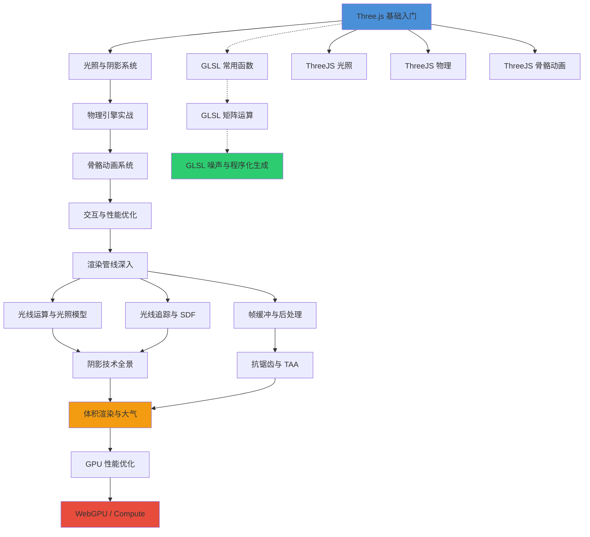

# WebGL 与 Three.js 学习导航

[[toc]]

---

## 学习路径建议

推荐按以下顺序阅读，由浅入深：

1. **基础入门** → 掌握核心概念与基本使用
2. **光照阴影** → 让场景有质感
3. **物理引擎** → 给物体加入真实碰撞与重力
4. **骨骼动画** → 角色与复杂动画
5. **交互优化** → 性能调优与工程化
6. **渲染管线** → 理解光照计算与追踪
7. **后处理管线** → 帧缓冲、后处理效果、抗锯齿
8. **高级渲染** → 体积渲染、阴影技术、WebGPU

| 阶段 | 文章数 | 预计时间 | 难度 |
|------|--------|----------|------|
| 基础入门 | 2 篇 | 2-3 天 | ⭐ |
| GLSL 基础 | 3 篇 | 3-5 天 | ⭐⭐ |
| Three.js 进阶 | 5 篇 | 5-7 天 | ⭐⭐ |
| 渲染管线 | 4 篇 | 5-7 天 | ⭐⭐⭐ |
| 高级主题 | 3 篇 | 7-10 天 | ⭐⭐⭐⭐ |

---

## 学习路径图



---

## 文章索引

### Three.js 系列

| 文章 | 关键词 | 难度 | 前置要求 | 说明 |
|------|--------|------|----------|------|
| [ThreeJS 基础入门与核心对象](./ThreeJS基础入门与核心对象.md) | Scene / Camera / Renderer / Geometry / Material / BufferGeometry | ⭐ | 无 | 环境搭建、三大核心、物体系统、坐标变换、动画循环 |
| [ThreeJS 光照与阴影系统](./ThreeJS光照与阴影系统.md) | 光源类型 / shadowMap / 烘焙 / HDR / PMREM | ⭐⭐ | 基础入门 | 6 种光源详解、阴影调优、光照烘焙、环境贴图 |
| [ThreeJS 物理引擎实战](./ThreeJS物理引擎实战.md) | cannon-es / 碰撞 / 重力 / 刚体 / 约束 | ⭐⭐ | 基础入门 | 物理引擎集成、碰撞检测、材料摩擦、性能优化 |
| [ThreeJS 骨骼动画系统](./ThreeJS骨骼动画系统.md) | SkinnedMesh / GLTF / AnimationMixer / 骨骼绑定 | ⭐⭐ | 基础入门 | 加载外部动画、动画混合过渡、程序化骨骼 |
| [ThreeJS 交互与性能优化](./ThreeJS交互与性能优化.md) | OrbitControls / Raycaster / InstancedMesh / LOD | ⭐⭐⭐ | 基础入门 | 交互控制、点击拾取、实例化渲染、纹理压缩 |

### GLSL 基础与参考

| 文章 | 关键词 | 难度 | 前置要求 | 说明 |
|------|--------|------|----------|------|
| [GLSL 常用函数](./GLSL%20常用函数.md) | 数学 / 三角函数 / 指数 / 向量 / 矩阵 | ⭐ | 无 | GLSL ES 3.0+ 常用函数速查手册 |
| [GLSL 矩阵运算深度解析](./GLSL%20矩阵运算深度解析.md) | 矩阵 / 坐标变换 / 法线矩阵 / TBN | ⭐⭐ | 常用函数 | 矩阵基础、向量空间、正交基、正则化 |
| [GLSL 噪声函数与程序化生成](./GLSL%20噪声函数与程序化生成.md) | Perlin / Simplex / FBM / Voronoi / Worley | ⭐⭐⭐ | 常用函数 | 经典噪声算法、程序化地形、云朵、纹理 |

### 渲染管线与高级主题

| 文章 | 关键词 | 难度 | 前置要求 | 说明 |
|------|--------|------|----------|------|
| [光线运算与光照模型](./光线运算与光照模型.md) | 半兰模型 / PBR / BRDF / IBL | ⭐⭐⭐ | GLSL 基础 | Phong / Blinn-Phong / 半兰光照 / PBR |
| [光线追踪与 SDF 渲染原理](./光线追踪与%20SDF%20渲染原理.md) | Ray Marching / SDF / 软阴影 / AO | ⭐⭐⭐ | 矩阵运算 | 签名距离场、光线追踪、渲染调试 |
| [帧缓冲与后处理管线](./帧缓冲与后处理管线.md) | Framebuffer / MRT / FBO / Bloom / SSAO | ⭐⭐⭐ | GLSL 基础 | FBO操作、多目标渲染、口径光季、屏幕空间后处理 |
| [阴影技术全景](./阴影技术全景.md) | Shadow Map / PCF / PCSS / VSM / CSM | ⭐⭐⭐ | 光照模型 | 硬阴影、软阴影、级联阴影、联系阴影 |
| [抗锯齿与 TAA](./抗锯齿与TAA.md) | MSAA / FXAA / SMAA / TAA / DLSS | ⭐⭐⭐ | 帧缓冲管线 | 时间抗锯齿、穿越缓冲、八后检测 |
| [体积渲染与大气效果](./体积渲染与大气效果.md) | Ray Marching / Beer-Lambert / Rayleigh / Mie | ⭐⭐⭐⭐ | 光线追踪、噪声 | 体积光、大气散射、云朵渲染 |
| [GPU 性能优化与着色器调试](./GPU%20性能优化与着色器调试.md) | Uniform / Varying / Branching / 渲染状态 | ⭐⭐⭐ | GLSL 基础 | 结构化缓冲区、并行计算、性能评测、调试工具 |
| [WebGPU 与 Compute Shader 入门](./WebGPU%20与%20Compute%20Shader%20入门.md) | WebGPU / WGSL / Compute / 并行计算 | ⭐⭐⭐⭐ | GLSL 基础、性能优化 | 从 WebGL 迁移、通用计算、粒子系统 |

---

## 快速开始

如果你刚接触 Three.js，直接从这里开始：

```bash
# 1. 创建 Vite 项目
npm create vite@latest my-3d-app -- --template vanilla

# 2. 安装 Three.js
cd my-3d-app
npm install three

# 3. 启动开发服务器
npm run dev
```

```js
// main.js
import * as THREE from 'three';

const scene = new THREE.Scene();
const camera = new THREE.PerspectiveCamera(75, innerWidth / innerHeight, 0.1, 1000);
camera.position.z = 5;

const renderer = new THREE.WebGLRenderer({ antialias: true });
renderer.setSize(innerWidth, innerHeight);
document.body.appendChild(renderer.domElement);

const geometry = new THREE.BoxGeometry();
const material = new THREE.MeshStandardMaterial({ color: 0x00ff00 });
const cube = new THREE.Mesh(geometry, material);
scene.add(cube);

const light = new THREE.DirectionalLight(0xffffff, 1);
light.position.set(5, 5, 5);
scene.add(light);

function animate() {
    requestAnimationFrame(animate);
    cube.rotation.x += 0.01;
    cube.rotation.y += 0.01;
    renderer.render(scene, camera);
}
animate();
```

---

## 奇淫技巧：一键创建 Three.js 项目

使用官方推荐的脚手架快速起步：

```bash
# 使用 create-three 脚手架
npx create-three@latest my-app

# 或使用 Vite 模板
npm create vite@latest my-app -- --template vanilla
cd my-app && npm install three
```

---

## 精选在线示例汇总

每篇文章都附有 ShaderToy / Three.js / WebGPU 在线示例，可直接在浏览器中运行：

| 类别 | 示例数 | 代表示例 |
|------|--------|---------|
| Three.js 官方示例 | 10+ | [Examples](https://threejs.org/examples/) / [Manual](https://threejs.org/manual/) |
| ShaderToy GLSL | 25+ | 噪声、光照、SDF、体积渲染、后处处理 |
| WebGPU Samples | 2 | [Official Samples](https://webgpu.github.io/webgpu-samples/) |
| 物理引擎 | 2 | [Cannon-es](https://pmndrs.github.io/cannon-es/) / [Rapier](https://rapier.rs/demos3d/index.html) |

建议学习时一边看文章、一边在 ShaderToy 上修改代码，效率最高。

---

## 奇淫技巧：学习加速通道

- **快速试错**: 每篇文章下的 ShaderToy 链接都可以点击**直接运行**，修改参数看效果，比阅读更直观
- **交叉阅读**: 难题去看"相关阅读"链接的文章，形成知识网络
- **先做后学**: 先跑通 Three.js 官方示例，再回来补充理论
- **性能对比**: 同一效果多换几个算法试（如 FXAA vs TAA），理解各有千秋
- **代码画画**: 写一个 shader，用变量控制第三个色彩通道，绘制调试图

---

## 参考资料

- [Three.js 官方文档](https://threejs.org/docs/)
- [Three.js 示例](https://threejs.org/examples/)
- [cannon-es GitHub](https://github.com/pmndrs/cannon-es)
- [glTF 规范](https://www.khronos.org/gltf/)
- [Rapier 物理引擎](https://rapier.rs/)
- [ShaderToy](https://www.shadertoy.com/)
- [WebGPU 官方示例](https://webgpu.github.io/webgpu-samples/)
- [Inigo Quilez - iq](https://iquilezles.org/) — SDF 大师
