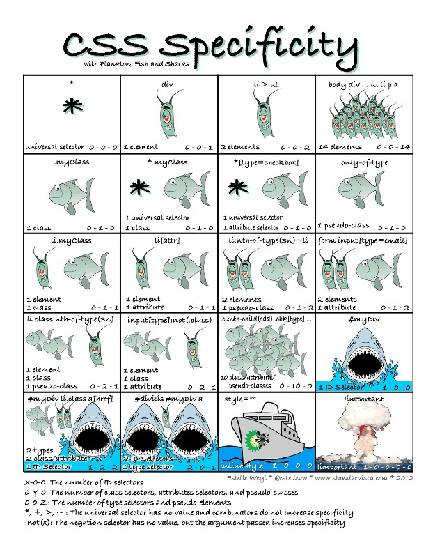

# css优先级

```text
来源与重要性 → 层叠层（@layer）→ 特异性 → 源码顺序
```

同一来源、同一层内，优先级从高到低为：`!important` > 行内样式 > ID > 类/伪类/属性 > 元素/伪元素。



CSS优先级（Specificity）用于确定当多个规则作用于同一元素时，哪个样式将生效。其计算规则基于选择器的类型，**优先级从高到低**如下：

> 特异性只在“来源、重要性、层叠层”都相同的情况下才有机会比较。跨层时，`@layer` 的顺序优先于特异性。

---

## **1. 优先级层级（由高到低）**

| 选择器类型               | 示例                           | 权重值表示法 (A,B,C,D) |
| ------------------------ | ------------------------------ | ---------------------- |
| **内联样式**             | `<div style="...">`            | `1,0,0,0`              |
| **ID选择器**             | `#header`                      | `0,1,0,0`              |
| **类/伪类/属性选择器**   | `.class`, `:hover`, `[type=*]` | `0,0,1,0`              |
| **元素/伪元素选择器**    | `div`, `::before`              | `0,0,0,1`              |
| **通配符/继承/子选择器** | `*`, `>`                       | `0,0,0,0`              |

---

## **2. 计算规则**

- **将选择器拆分为四组 `(A, B, C, D)`**：
    - **A**：内联样式（存在则为1，否则0）。
    - **B**：ID选择器的数量。
    - **C**：类、伪类（`:hover`）、属性选择器（`[type="text"]`）的数量。
    - **D**：元素选择器（`div`）、伪元素（`::before`）的数量。

- **比较方法**：  
  从左到右逐级比较（A → B → C → D），数值大的优先级更高。  
  **示例**：
    ```css
    #nav .item a:hover  /* (0,1,2,1) → A=0, B=1, C=2, D=1 */
    body #sidebar .link  /* (0,1,1,1) → A=0, B=1, C=1, D=1 */
    ```
    第一个选择器优先级更高（比较到C时，2 > 1）。

---

## **3. 特殊情况规则**

- **`!important`**：  
  直接覆盖所有其他规则（**慎用**），但内联样式加 `!important` 的优先级最高。

    ```css
    p {
        color: red !important;
    } /* 最高优先级 */
    ```

- **相同优先级**：  
  后定义的样式覆盖先定义的（源码顺序靠后的生效）。

- **继承的样式**：  
  优先级最低（低于通配符 `*`）。

- **组合选择器**：  
  `+`, `>`, `~` 等组合符不增加优先级，仅影响选择逻辑。

- **`:not()` 伪类**：  
  自身不计入优先级，但内部的选择器参与计算。
    ```css
    div: not(#id); /* 优先级 = (0,1,0,1)（#id 参与计算） */
    ```

---

## **4. 示例对比**

| 选择器示例              | 权重值    | 计算逻辑                |
| ----------------------- | --------- | ----------------------- |
| `style="color:red"`     | `1,0,0,0` | 内联样式                |
| `#main .list li.active` | `0,1,2,1` | 1个ID + 2个类 + 1个元素 |
| `ul#menu li.item`       | `0,1,1,2` | 1个ID + 1个类 + 2个元素 |
| `a:hover`               | `0,0,1,1` | 1个伪类 + 1个元素       |
| `div p`                 | `0,0,0,2` | 2个元素                 |
| `*`                     | `0,0,0,0` | 通配符                  |

---

## **5. 优先级速记技巧**

- **ID选择器** 是最高权重（除内联和`!important`）。
- **100个类** < **1个ID**（因为比较顺序：B > C）。
- 实际开发中避免过度嵌套，用类选择器更可控。

> 💡 总结：优先级计算 = **内联 > ID > 类/伪类 > 元素**，比较时从左到右逐级对比。

---

## **6. 层叠层（Cascade Layers）**

`@layer` 在比较特异性之前先把声明分桶。层顺序在第一次出现时确定，后声明的层优先级更高；只有同一层内部才比较特异性。

```css
@layer base, components, utilities;

@layer base {
    #app .btn { color: blue; } /* 特异性 1,1,0 */
}

@layer utilities {
    .btn { color: red; } /* 特异性 0,1,0，但在更晚的层 */
}

/* 最终颜色：红色 */
```

普通声明和 `!important` 的方向相反：

| 声明类型 | 从低到高 |
| --- | --- |
| 普通声明 | 最早层 → 最晚层 → 未分层 → 行内 `style` |
| `!important` | 未分层 → 最晚层 → 最早层 → 行内 `!important` |

几个容易记错的点：

- 未分层的**普通**样式高于所有普通层；层内的 `!important` 高于未分层的 `!important`。
- 动画（`@keyframes`）压过普通声明，过渡（`transition`）压过 `!important`。
- `revert-layer` 让属性回退到当前来源的上一层；`revert` 直接回退到上一个来源。
- 层不跨 Shadow DOM / iframe，每个文档都有独立的层顺序。

完整语法、嵌套层、`@import layer()`、`revert-layer` 与 CSSOM 用法见 [CSS 级联层 Cascade Layers](./CSS%20级联层%20Cascade%20Layers.md)。

---

## 奇淫技巧

### 技巧 1：利用 `:where()` 降低特异性

```css
/* :where() 内部选择器不计入特异性 */
:where(.btn, .link) {
    color: blue; /* 特异性 = 0,0,0,0 */
}
.btn { color: red; } /* 特异性 = 0,0,1,0 → 红色 */
```

### 技巧 2：利用 `:is()` 保持特异性

```css
/* :is() 保留内部最高特异性 */
:is(.btn, #id) {
    color: blue; /* 特异性 = 0,1,0,0 */
}
```

### 技巧 3：避免 `!important` 使用

```css
/* 坏例 */
.btn { color: red !important; }

/* 好例：增加选择器特异性 */
.btn.btn-primary {
    color: blue; /* 特异性更高，无需 !important */
}
```

### 技巧 4：CSS 变量优先级

```css
/* 自定义属性优先级更高 */
:root { --color: blue; }
.btn { color: var(--color); }

/* 覆盖 */
.btn.primary {
    --color: red; /* 仅覆盖 .btn 内部的 --color */
}
```

### 技巧 5：源码顺序规则

```css
/* 同优先级时，后定义覆盖先定义 */
.alert { color: blue; }
.alert { color: red; } /* 最终生效为红色 */
```

### 技巧 6：用层叠层而不是加权重

```css
@layer base, overrides;

@layer base {
    #app .btn { color: blue; } /* 特异性 1,1,0 */
}

@layer overrides {
    .btn { color: red; } /* 特异性 0,1,0，但层更靠后 */
}

/* 最终颜色：红色 */
```

跨层比较时，层顺序先于特异性；不要再靠堆 ID 或 `!important` 来覆盖第三方样式。

### 技巧 7：计算器资源

```text
使用 https://specificity.keegan.st/ 计算特异性
也可在浏览器控制台执行 getComputedStyle() 查看最终值
```

### 技巧 8：强制覆盖策略

```css
/* 增加父级 ID（不推荐，权重会越来越高） */
#app .component .btn { }

/* 增加双类名（局部可用） */
.btn.btn-primary { }

/* 更好：用 @layer 把被覆盖方放进低优先级层 */
@layer vendor, app;
```

### 技巧 9：避免深度嵌套

```css
/* 坏：过深的选择器 */
#app .container .row .col .card .body .btn { }

/* 好：平坦化 */
.btn-primary { }
```

### 技巧 10：性能优化

```css
/* 从右往左读取的选择器更快 */
.btn { }              /* 快 */
button.btn { }        /* 较快 */
#app button.btn { }   /* 较慢 */
```

> 💡 **记住**：
> - 特异性计算 = **(0, ID数, 类/伪类/属性数, 元素/伪元素数)**
> - `!important` 会打断优先级层叠，尽量避免使用
> - 源码顺序是同优先级下的最后一道防线
