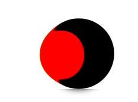

原理:
内部求: 使用 blur(5) 模糊边缘,然后当两个图片相重叠后,
相互交叉部分由于图片颜色变重, 提高图片对比度后交叉部分颜色显示出来,形成水滴
外部: 使用 contrast(10) 提高对比度

在给 外部 加上白色背景颜色,



---

## 奇淫技巧

### 技巧 1：完整代码

```html
<div class="gooey">
    <div class="ball"></div>
    <div class="ball"></div>
</div>
```

```css
.gooey {
    background: #fff;
    filter: contrast(10);
}
.ball {
    width: 100px; height: 100px;
    background: #000;
    border-radius: 50%;
    filter: blur(5px);
    animation: move 2s infinite alternate;
}
@keyframes move {
    from { transform: translateX(0); }
    to   { transform: translateX(150px); }
}
```

### 技巧 2：调整粘度

```css
.gooey {
    filter: contrast(20); /* 值越大，粘合越紧密 */
}
.ball {
    filter: blur(8px); /* 值越大，边缘越柔和 */
}
```

### 技巧 3：多球效果

```css
.ball:nth-child(1) { animation-delay: 0s; }
.ball:nth-child(2) { animation-delay: 0.5s; }
.ball:nth-child(3) { animation-delay: 1s; }
```

### 技巧 4：变色水滴

```css
.ball {
    background: linear-gradient(45deg, #ff6b6b, #4ecdc4);
}
```
